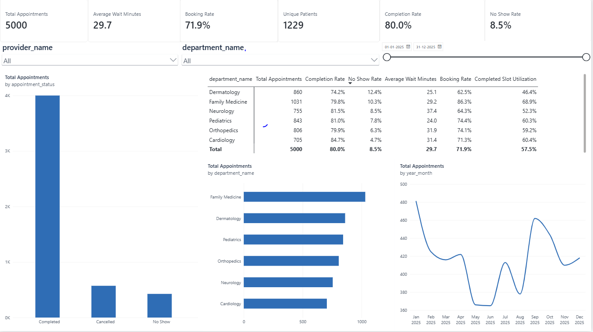
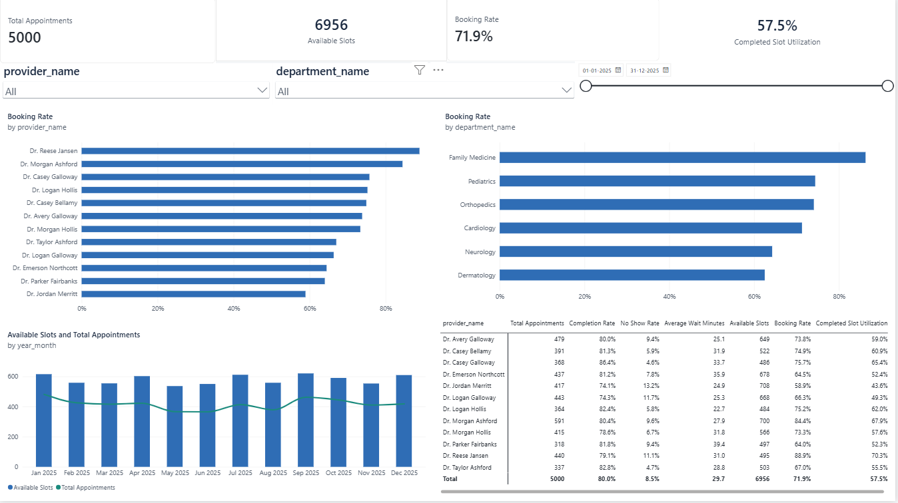
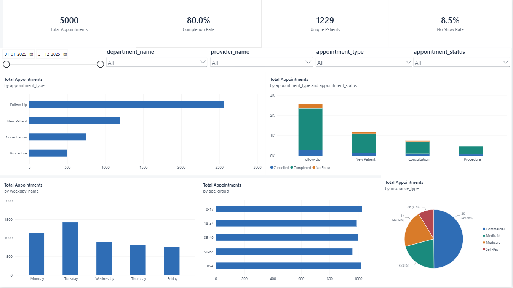

# Healthcare Patient Flow & Operational Analytics Platform

An academic portfolio project that analyzes how patients move through a fictional outpatient
clinic: patient volume, appointment activity, waiting time, provider and department
utilization, appointment status (completed, cancelled, no-show), and trends over time.

> **Synthetic data notice:** Every record in this project is generated by
> `generate_data.py`. Patients, providers, departments, cities and all other values are
> fictional. The data does not come from, represent, or describe any real person, hospital,
> or clinic.

## Workflow

```
synthetic data  ->  Python/Pandas cleaning  ->  SQL analysis  ->  Excel outputs  ->  Power BI dashboard
```

Tools: Python, Pandas, SQL (SQLite), Excel and Power BI. Every step in this workflow
exists, ending with a Power BI dashboard that was built by hand in Power BI Desktop (see
[Roadmap](#roadmap)).

## Current status: Phases 1–4 complete

**Phase 1: synthetic data**
- A deterministic synthetic data generator: the same seed always gives the same files.
- Five related CSV tables written to `data/raw/`.

**Phase 2: cleaning, validation and SQLite**
- `prepare_data.py` checks the raw files, builds cleaned CSV files in `data/processed/`,
  loads them into a local SQLite database, and writes a data-quality report.
- `sql/01_create_schema.sql` defines the database tables, keys, checks and indexes.

**Phase 3: SQL analytics and Excel report**
- `sql/02_create_analytics_views.sql` calculates every KPI in SQL views.
- `analyze_data.py` builds the views, checks that all breakdowns add up to the overall
  totals, and exports six CSV files to `data/output/analytics/`.
- `create_excel_report.py` writes the Excel workbook
  `reports/healthcare_patient_flow_report.xlsx`.

**Phase 4: Power BI dashboard**
- **4A:** `prepare_powerbi_data.py` exports a validated Power BI snapshot to
  `powerbi/data/` and reference KPI values to `powerbi/expected_kpis.json`. `powerbi/`
  also holds the star-schema specification, data dictionary, DAX measures, theme, build
  guide and verification checklist.
- **4B:** the dashboard `powerbi/healthcare_patient_flow_dashboard.pbix` was built by
  hand in Power BI Desktop. It has three pages, each with a screenshot in `screenshots/`.
  Its headline KPIs match `expected_kpis.json`.

The automated tests (pytest) cover Phases 1–3, the Phase 4A files, and the presence and
validity of the `.pbix` and screenshot files. They cannot open or calculate the Power BI
report itself; those checks were done by hand (see
[Dashboard verification](#dashboard-verification)).

### Raw tables (Phase 1)

| File | One row per | Columns |
|---|---|---|
| `departments.csv` | department | department_id, department_name |
| `providers.csv` | provider | provider_id, department_id, provider_name, specialty, daily_slot_capacity |
| `patients.csv` | patient | patient_id, age, age_group, gender, city, insurance_type |
| `appointments.csv` | booked appointment | appointment_id, patient_id, provider_id, department_id, appointment_date, scheduled_time, check_in_time, seen_time, checkout_time, appointment_type, appointment_status |
| `provider_schedules.csv` | provider clinic day | schedule_date, provider_id, department_id, available_slots |

### How the data is built

- **Period:** calendar year 2025, weekdays only (clinic hours start at 08:00, with 30-minute slots).
- **Departments:** 6 (Family Medicine, Pediatrics, Cardiology, Orthopedics, Dermatology,
  Neurology) with 2 providers each.
- **Schedules:** each provider works fixed weekdays. The number of clinic days per week is
  chosen so that roughly 75% of slots are booked. A few clinic days have reduced slots or
  zero slots (provider away).
- **Demand:** busier in winter, quieter in summer, busier early in the week. Some
  departments are more in demand than others.
- **Status:** `Completed`, `Cancelled` or `No Show`. Rates differ by department, with
  slightly more cancellations in winter.
- **Times** (`HH:MM`, on `appointment_date`):
  - *Completed:* the patient checks in between 20 minutes early and 10 minutes late. They
    are seen after both check-in and the scheduled time, then check out after a visit
    whose length depends on the appointment type. Waits grow later in the day and on Mondays.
  - *Cancelled* and *No Show:* only `scheduled_time` is filled in. `check_in_time`,
    `seen_time` and `checkout_time` are left blank.
- **Patients:** Pediatrics sees only patients under 18; other specialist departments see
  adults; Family Medicine sees everyone. A patient has at most one appointment per day.
- All settings live in `config.py`.

## Phase 2: raw to processed

```
data/raw/*.csv  ->  prepare_data.py  ->  data/processed/*.csv
                                          data/processed/healthcare_analytics.db
                                          data/output/phase2_data_quality.json
```

`prepare_data.py` runs these steps in order:

1. **Read** the five raw CSV files. If any file is missing, it stops and explains how to
   run `generate_data.py`.
2. **Tidy:** remove accidental spaces around values. This is the only automatic fix.
3. **Validate.** Every rule must pass:
   - required columns exist, and required values are not blank;
   - primary keys are unique;
   - foreign keys match their parent tables;
   - each appointment falls on one of its provider's clinic days;
   - each appointment's and schedule's department matches the provider's department;
   - age is a whole number from 0 to 120, and age_group matches age;
   - appointment status is `Completed`, `Cancelled` or `No Show`, and the appointment
     type is one of the four known types;
   - provider capacity is a positive whole number, and schedule slots are a whole number
     from 0 to the provider's capacity;
   - bookings per provider per day do not exceed the available slots;
   - Completed appointments have valid times in the order check-in ≤ seen ≤ checkout;
   - Cancelled and No Show appointments have blank check-in, seen and checkout times.

   If any rule fails, the script stops with a message listing each problem and example
   IDs. It writes a report with `"pipeline_status": "failed"` and leaves the processed
   folder unchanged.
4. **Clean:** convert numbers to integers, build full datetimes, calculate durations, and
   sort each table by its key. The result goes to `data/processed/*.csv`.
5. **Load SQLite:** rebuild `data/processed/healthcare_analytics.db` from
   `sql/01_create_schema.sql`, load the tables in dependency order (departments,
   providers, patients, provider_schedules, appointments), confirm the row counts match
   the CSV files, and run `PRAGMA foreign_key_check`.
6. **Report:** write `data/output/phase2_data_quality.json` with the following:
   - row counts;
   - duplicate-key, blank-value, foreign-key and rule-violation counts;
   - appointment status counts;
   - minimum, maximum and average wait and visit minutes;
   - the foreign-key check result;
   - a synthetic-data notice.

   It has no timestamp, so the same input always gives the same file.

Running the script again is safe. It overwrites the processed CSV files and the report,
and drops and recreates the database tables.

### Processed appointment fields

Raw `HH:MM` times are combined with `appointment_date` into datetimes stored as ISO text,
`YYYY-MM-DD HH:MM:SS`. Dates are stored as `YYYY-MM-DD`.

| Field | Meaning |
|---|---|
| `scheduled_datetime` | Booked start time (all appointments) |
| `check_in_datetime`, `seen_datetime`, `checkout_datetime` | Visit times (Completed only, blank otherwise) |
| `wait_minutes` | `seen_datetime - check_in_datetime` (Completed only) |
| `visit_minutes` | `checkout_datetime - seen_datetime` (Completed only) |

**Early check-in is valid.** Patients may check in before their scheduled time, and
`wait_minutes` starts at the actual check-in, not at the scheduled time. A patient who
arrives 15 minutes early and is seen on time therefore has a 15-minute wait. For Cancelled
and No Show appointments, the visit times and both durations are blank in the CSV and NULL
in the database.

### Database tables

SQLite file: `data/processed/healthcare_analytics.db`. It is created by Python's built-in
`sqlite3` module, with foreign-key enforcement turned on.

| Table | Primary key | Contents |
|---|---|---|
| `departments` | `department_id` | The six clinic departments |
| `providers` | `provider_id` | Fictional providers, their department, specialty and daily slot capacity |
| `patients` | `patient_id` | Fictional patients: age, age group, gender, city, insurance type |
| `provider_schedules` | `schedule_date` + `provider_id` | Available slots per provider per clinic day (0 = provider away) |
| `appointments` | `appointment_id` | Every booked appointment, with datetimes, durations, type and status |

The schema also contains the following:
- foreign keys between related tables, including appointments to provider schedules;
- CHECK constraints for:
  - age from 0 to 120;
  - capacity above 0 and slots of 0 or more;
  - valid status and type values;
  - date and datetime formats;
  - time order;
  - non-negative durations;
  - visit times present only for Completed appointments;
- indexes on appointment date, status, department, provider and patient.

## Phase 3: KPIs, SQL analytics and Excel report

### KPI definitions

The same definitions are used in SQL, Python, Excel and this README.

| KPI | Formula |
|---|---|
| Total Appointments | All appointment records (every status) |
| Unique Patients | Distinct patients with at least one appointment |
| Completed Appointments | Appointments with `appointment_status = 'Completed'` |
| Cancelled Appointments | Appointments with `appointment_status = 'Cancelled'` |
| No Show Appointments | Appointments with `appointment_status = 'No Show'` |
| Completion Rate | Completed Appointments / Total Appointments |
| Cancellation Rate | Cancelled Appointments / Total Appointments |
| No Show Rate | No Show Appointments / Total Appointments |
| Average Wait Minutes | Average `wait_minutes`, Completed appointments only |
| Average Visit Minutes | Average `visit_minutes`, Completed appointments only |
| Available Slots | Sum of `provider_schedules.available_slots` |
| Booking Rate | Total Appointments / Available Slots |
| Completed Slot Utilization | Completed Appointments / Available Slots |

These rules apply to every KPI:
- A rate is left blank (`NULL` in SQL, an empty cell in Excel) when its denominator is 0.
- Overall rates are calculated from overall counts, never by averaging department or
  provider percentages.
- Average durations for a group of rows are weighted by completed appointments.

**Booking Rate vs. Completed Slot Utilization.** Every appointment, whatever its status,
used a slot when it was booked:
- **Booking Rate** counts Completed, Cancelled and No Show appointments. It shows how
  much of the available capacity was booked.
- **Completed Slot Utilization** counts only Completed appointments. It shows how much of
  the capacity turned into a completed visit.
- The gap between the two is the share of slots that were booked but not used for a
  completed visit.

### SQL views (`sql/02_create_analytics_views.sql`)

The script drops and recreates every view, so it is safe to run again. Each view counts
appointments and adds up capacity separately before joining the two, so neither side is
multiplied by the join.

| View | One row per | Capacity metrics |
|---|---|---|
| `vw_overall_kpis` | whole dataset (plus reporting period and unique patients) | Yes |
| `vw_monthly_trends` | month (`YYYY-MM`) | Yes |
| `vw_department_performance` | department, including any with no appointments | Yes |
| `vw_provider_performance` | provider, including any with capacity but no appointments | Yes |
| `vw_appointment_type_performance` | appointment type | No |
| `vw_weekday_activity` | weekday (1 = Monday) | Yes |

Appointment types have no capacity metrics because slots are not reserved per type, so
there is no valid capacity denominator. Two helper views, `vw_appointment_details` and
`vw_schedule_details`, add status flags, month and weekday to each row.

`analyze_data.py` runs these steps:
1. Applies the views.
2. Queries each view in a fixed sort order.
3. Runs 37 reconciliation checks:
   - the overall totals match the database tables;
   - Completed + Cancelled + No Show equals the total;
   - each breakdown's counts and slots add up to the overall values;
   - each breakdown's completed-weighted averages equal the overall averages.
4. Exports the CSV files to `data/output/analytics/`:
   - `overall_kpis.csv`
   - `monthly_trends.csv`
   - `department_performance.csv`
   - `provider_performance.csv`
   - `appointment_type_performance.csv`
   - `weekday_activity.csv`

Any mismatch stops the script with an error that lists the failed checks.

### Excel workbook (`reports/healthcare_patient_flow_report.xlsx`)

| Sheet | Contents |
|---|---|
| Summary | Title, reporting period, synthetic-data notice, 13 KPIs with definitions, and three charts: monthly appointment volume, appointments by status, appointments by department |
| Monthly Trends | One row per month in date order: counts, status rates, average wait and visit, slots, booking rate, utilization, and a Total row |
| Department Analysis | One row per department, sorted by department ID (the order in `config.py`) |
| Provider Analysis | One row per provider, sorted by department ID and then provider ID; includes daily slot capacity |
| Appointment Types | Volume, share of appointments, status rates and durations; no capacity metrics |
| Data Quality | Audit sheet: synthetic-data status, Phase 2 row counts and validation checks (all 0), SQLite foreign-key check, Phase 3 reconciliation results. No other sheet uses it |
| Appointment Data | Every processed appointment, as an Excel table with filters |
| Capacity Data | Every provider clinic day with available slots and capacity, as an Excel table with filters |

How the workbook is built:
- **Values and formulas:** counts and average durations are the values from the SQL
  views. Rates are Excel formulas such as `=IF(B5=0,"",C5/B5)`, with the numerator and
  denominator cells on the same row, so they are blank instead of `#DIV/0!` when there is
  nothing to divide by.
- **Total rows:** each Total row sums the counts, recalculates the rates from those sums,
  and weights the average durations by completed appointments.
- **Dates:** dates and datetimes are real Excel date values, shown as `mm/dd/yyyy` and
  `mm/dd/yyyy hh:mm`. IDs are stored as text.
- **Layout:** analysis tables and data tables are Excel tables with filters and banded
  rows, and header rows are frozen.
- **Recalculation:** the workbook asks Excel to recalculate all formulas when it opens.
  The script writes formulas without stored results, so open the file in Excel to see the
  calculated rates.

The workbook is a portfolio deliverable and is tracked by Git, unlike the files under
`data/`. If `create_excel_report.py` says it cannot write the file, close the workbook in
Excel and run it again.

## Phase 4: Power BI dashboard

### Dashboard (`powerbi/healthcare_patient_flow_dashboard.pbix`)

The dashboard was built by hand in Power BI Desktop from the Phase 4A files. Python does not
create or edit the `.pbix` file. Open it in Power BI Desktop (Windows) to explore it. The
screenshots below show each page with no slicer selections.

**Page 1: Operational Overview**
(`screenshots/powerbi_operational_overview.png`)
- **Cards:** Total Appointments, Average Wait Minutes, Booking Rate, Unique Patients,
  Completion Rate, No Show Rate.
- **Slicers:** Provider, Department, Date range.
- **Charts and matrix:**
  - appointments by status (column chart);
  - department KPI matrix: appointments, completion rate, No Show rate, average wait,
    booking rate and completed slot utilization, with a Total row;
  - appointments by department (bar chart);
  - monthly appointment volume (line chart, Jan–Dec 2025).



**Page 2: Capacity and Provider Performance**
(`screenshots/powerbi_capacity_provider_performance.png`)
- **Cards:** Total Appointments, Available Slots, Booking Rate, Completed Slot
  Utilization.
- **Slicers:** Provider, Department, Date range.
- **Charts and matrix:**
  - booking rate by provider and by department (bar charts);
  - monthly Available Slots (columns) and Total Appointments (line) on one axis;
  - provider matrix: appointments, completion rate, No Show rate, average wait, available
    slots, booking rate and completed slot utilization, with a Total row.



**Page 3: Patient and Appointment Patterns**
(`screenshots/powerbi_patient_appointment_patterns.png`)
- **Cards:** Total Appointments, Completion Rate, Unique Patients, No Show Rate.
- **Slicers:** Date range, Department, Provider, Appointment Type, Appointment Status.
- **Charts:**
  - appointments by type;
  - status by appointment type (stacked columns);
  - appointments by weekday (Monday–Friday);
  - appointments by age group;
  - appointments by insurance type (pie).
- **No capacity measures** on this page: appointment type, status and patient fields do
  not define provider capacity.



### Dashboard verification

[POWER_BI_VERIFICATION_CHECKLIST.md](powerbi/POWER_BI_VERIFICATION_CHECKLIST.md) records
how each check was done:
- **Automated file tests:** the snapshot, DAX file, theme and documents, and that the
  `.pbix` and PNG files exist, are valid and are tracked by Git.
- **Screenshot review:** the values visible on each page were recomputed from
  `powerbi/data/`.
- **Checks in Power BI Desktop:** done by the project owner.

Screenshots cannot prove hidden model settings such as relationships or data types. Those
were confirmed in Power BI Desktop.

| Check (seed 42, no slicers) | Expected | Dashboard |
|---|---|---|
| Total Appointments | 5,000 | 5000 |
| Unique Patients | 1,229 | 1229 |
| Completion Rate | 80.0% | 80.0% |
| No Show Rate | 8.5% | 8.5% |
| Average Wait Minutes | 29.7 | 29.7 |
| Available Slots | 6,956 | 6956 |
| Booking Rate | 71.9% | 71.9% |
| Completed Slot Utilization | 57.5% | 57.5% |

Slicer checks in Power BI Desktop:
- Department = Cardiology gave 705 appointments and limited the Provider choices.
- Appointment Status = No Show gave 427 appointments and a 100.0% No Show Rate.

The approved dashboard differs from some formatting suggestions in the build guide. For
example, it uses automatic visual titles, count cards without thousands separators, and
no on-canvas synthetic-data notice. These were accepted as final, and the checklist lists
them under "Accepted design choices".

### Phase 4A: Power BI preparation

Python **cannot** create, edit or check a `.pbix` file. Phase 4A prepared everything
needed for the manual build.

`prepare_powerbi_data.py` runs these steps:
1. Runs the Phase 3 SQL analytics and reconciliation.
2. Reads the five SQLite tables and builds a calendar Date table.
3. Checks primary keys, foreign keys and provider/department consistency. If anything
   fails, it writes nothing.
4. Writes the six CSV files and `expected_kpis.json`.
5. Reads the files back to confirm that row counts and headline KPIs match SQLite.

The output is identical on every run.

| Asset | Purpose |
|---|---|
| `powerbi/data/appointments.csv` | Fact: one row per appointment |
| `powerbi/data/provider_schedules.csv` | Fact: one row per provider clinic day (capacity) |
| `powerbi/data/providers.csv` | Dimension: providers |
| `powerbi/data/departments.csv` | Dimension: departments |
| `powerbi/data/patients.csv` | Dimension: patients |
| `powerbi/data/date.csv` | Dimension: every calendar day of each year in the data (Monday = 1) |
| `powerbi/expected_kpis.json` | Reference KPI values from the SQL view `vw_overall_kpis`, for checking the dashboard |
| `powerbi/POWER_BI_DATA_MODEL.md` | Star schema, six one-to-many single-direction relationships, date table and sort settings |
| `powerbi/DATA_DICTIONARY.md` | Every column: type, meaning, key, blanks, notes |
| `powerbi/dax_measures.txt` | 16 copy-ready DAX measures with the Phase 3 definitions and formats |
| `powerbi/healthcare_theme.json` | Power BI theme: navy titles, blue charts, teal / orange / muted red for status |
| `powerbi/POWER_BI_BUILD_GUIDE.md` | Step-by-step build of the three report pages (as built) |
| `powerbi/POWER_BI_VERIFICATION_CHECKLIST.md` | Verification record: file tests, screenshot checks, Power BI Desktop checks, accepted design choices |
| `powerbi/healthcare_patient_flow_dashboard.pbix` | The Power BI dashboard (Phase 4B, built by hand) |
| `screenshots/powerbi_*.png` | One screenshot per dashboard page (Phase 4B) |

File formats:
- CSV files are UTF-8.
- IDs are text.
- Dates are `YYYY-MM-DD` and datetimes are `YYYY-MM-DD HH:MM:SS`.
- Visit times and durations are blank for Cancelled and No Show appointments.

The snapshot files are tracked by Git so the dashboard can be rebuilt without running
Python. Re-run `prepare_powerbi_data.py` after regenerating the data.

The capacity measures (Available Slots, Booking Rate, Completed Slot Utilization) are
meaningful only with Date, Department and Provider filters. They must not be split by
appointment type or patient attributes, so they don't appear on the patient-patterns page.

## Setup and run (Windows PowerShell)

Tested with Python 3.12 (pandas 3 needs Python 3.11 or newer). Run these from the project
folder:

```powershell
# 1. Create and activate a virtual environment
python -m venv .venv
.\.venv\Scripts\Activate.ps1

# 2. Install dependencies
python -m pip install -r requirements.txt

# 3. Generate the raw synthetic data (five CSV files in data\raw)
python generate_data.py --appointments 5000 --seed 42

# 4. Validate, clean and load into SQLite (data\processed and data\output)
python prepare_data.py

# 5. Build the SQL views, check totals, export analysis CSVs (data\output\analytics)
python analyze_data.py

# 6. Create the Excel report (reports\healthcare_patient_flow_report.xlsx)
python create_excel_report.py

# 7. Export the Power BI snapshot (powerbi\data and powerbi\expected_kpis.json)
python prepare_powerbi_data.py

# 8. Run the tests
python -m pytest -q

# 9. Open the workbook in Excel
Invoke-Item .\reports\healthcare_patient_flow_report.xlsx
```

To view the dashboard, open `powerbi\healthcare_patient_flow_dashboard.pbix` in Power BI
Desktop. Rebuilding it is a manual step with no command; `powerbi\POWER_BI_BUILD_GUIDE.md`
describes it. If you regenerate the data with other settings, refresh the report in
Power BI Desktop and compare it with the new `expected_kpis.json`.

If PowerShell blocks `Activate.ps1`, run
`Set-ExecutionPolicy -Scope CurrentUser -ExecutionPolicy RemoteSigned` once, or skip
activation and call `.\.venv\Scripts\python.exe` in place of `python`.

Generator options:

| Option | Default | Meaning |
|---|---|---|
| `--appointments` | 5000 | Number of appointments to create |
| `--seed` | 42 | Random seed (same seed gives the same data) |
| `--patients` | appointments / 4 | Number of patients |
| `--output-dir` | `data\raw` | Folder for the CSV files |

`prepare_data.py` options: `--raw-dir`, `--processed-dir` and `--output-dir`. The defaults
are `data\raw`, `data\processed` and `data\output`. `analyze_data.py` accepts
`--database` and `--output-dir`; `create_excel_report.py` accepts `--database`,
`--quality-report` and `--output`; `prepare_powerbi_data.py` accepts `--database`,
`--output-dir` and `--expected-kpis`.

Everything under `data\` (CSV files, the database, the JSON report and the analysis
exports) is not tracked by Git. Re-create it at any time with steps 3 to 5. These are
tracked:
- the Excel workbook in `reports\`;
- the Power BI snapshot, documents and `.pbix` dashboard in `powerbi\`;
- the dashboard screenshots in `screenshots\`.

## Folder structure

```
healthcare-patient-flow-analytics/
├── data/
│   ├── raw/            # generated synthetic CSV files (Phase 1)
│   ├── processed/      # cleaned CSV files + healthcare_analytics.db (Phase 2)
│   └── output/
│       ├── phase2_data_quality.json   # Phase 2 data-quality report
│       └── analytics/                 # Phase 3 analysis CSV exports
├── reports/
│   └── healthcare_patient_flow_report.xlsx   # Phase 3 Excel report (tracked by Git)
├── sql/
│   ├── 01_create_schema.sql            # SQLite tables, keys, checks, indexes
│   └── 02_create_analytics_views.sql   # KPI views
├── powerbi/
│   ├── data/                    # Phase 4A Power BI snapshot: six CSV files (tracked)
│   ├── expected_kpis.json       # reference KPI values from SQL
│   ├── POWER_BI_DATA_MODEL.md   # star schema and relationships
│   ├── DATA_DICTIONARY.md       # every Power BI column
│   ├── dax_measures.txt         # DAX measure library
│   ├── healthcare_theme.json    # Power BI theme
│   ├── POWER_BI_BUILD_GUIDE.md  # manual build steps and page designs (as built)
│   ├── POWER_BI_VERIFICATION_CHECKLIST.md   # Phase 4B verification record
│   └── healthcare_patient_flow_dashboard.pbix  # Phase 4B dashboard (built by hand)
├── screenshots/
│   ├── powerbi_operational_overview.png
│   ├── powerbi_capacity_provider_performance.png
│   └── powerbi_patient_appointment_patterns.png
├── tests/
│   ├── conftest.py
│   ├── test_generate_data.py   # Phase 1 tests
│   ├── test_prepare_data.py    # Phase 2 tests
│   ├── test_analytics.py       # Phase 3 SQL and analytics tests
│   ├── test_excel_report.py    # Phase 3 workbook tests
│   └── test_powerbi_assets.py  # Phase 4 Power BI package and artifact tests
├── .gitignore
├── README.md
├── config.py               # all settings (generator, file paths)
├── generate_data.py        # Phase 1: synthetic data generator
├── prepare_data.py         # Phase 2: validate, clean, load SQLite, quality report
├── analyze_data.py         # Phase 3: SQL views, reconciliation, CSV exports
├── create_excel_report.py  # Phase 3: Excel workbook
├── prepare_powerbi_data.py # Phase 4A: Power BI snapshot and reference KPIs
└── requirements.txt
```

## Roadmap

| Phase | Scope | Status |
|---|---|---|
| 1 | Project structure, synthetic data generator, tests | Done |
| 2 | Validation, cleaning, derived fields, SQLite database, data-quality report, tests | Done |
| 3 | SQL KPI views, reconciliation, analysis CSV exports, Excel report, tests | Done |
| 4 | Power BI dashboard: **4A** data package, model, DAX, theme and guides; **4B** three-page `.pbix` built and checked by hand in Power BI Desktop, screenshots, verification record | Done |
| 5 | Final presentation: final documentation | Planned |

Planned work is not built yet, and its details may change.
