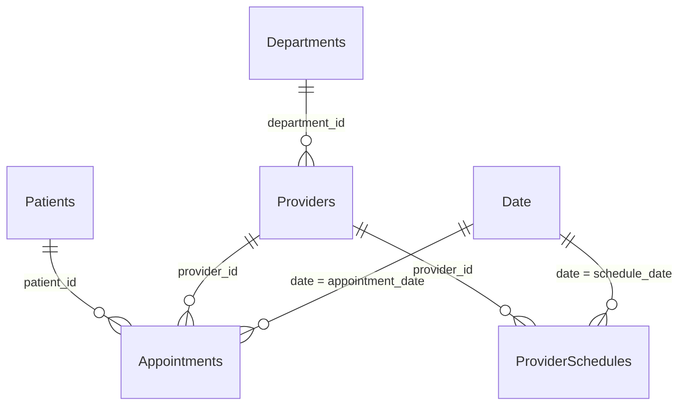

# Power BI Data Model (Star Schema)

> **Synthetic data only.** Every value comes from `generate_data.py`. Nothing describes
> real patients, providers, hospitals or clinics.

This document specifies the model to build in Power BI Desktop from the six CSV files in
`powerbi/data/`. The step-by-step clicks are in
[POWER_BI_BUILD_GUIDE.md](POWER_BI_BUILD_GUIDE.md). Every column is described in
[DATA_DICTIONARY.md](DATA_DICTIONARY.md).

## Tables

| Power BI table | Source file | Type | Grain (one row per) | Rows (seed 42) |
|---|---|---|---|---|
| Date | `date.csv` | Dimension | calendar day | 365 |
| Departments | `departments.csv` | Dimension | department | 6 |
| Providers | `providers.csv` | Dimension | provider | 12 |
| Patients | `patients.csv` | Dimension | patient | 1,250 |
| Appointments | `appointments.csv` | Fact | booked appointment | 5,000 |
| ProviderSchedules | `provider_schedules.csv` | Fact | provider clinic day | 626 |

Rename each query to the name in the first column when you import it. The DAX measures in
[dax_measures.txt](dax_measures.txt) use these names. `expected_kpis.json` lists the
current row counts.

## Relationships

Create exactly these six relationships. Each one has these settings:
- **Active**
- **Cardinality: One to many (1:\*)**
- **Cross-filter direction: Single**

| # | From (one side) | To (many side) | Why |
|---|---|---|---|
| 1 | `Date[date]` | `Appointments[appointment_date]` | Filter appointments by day, month, weekday |
| 2 | `Date[date]` | `ProviderSchedules[schedule_date]` | Filter capacity by the same dates |
| 3 | `Departments[department_id]` | `Providers[department_id]` | Each provider belongs to one department |
| 4 | `Providers[provider_id]` | `Appointments[provider_id]` | Appointments by provider (and so by department) |
| 5 | `Providers[provider_id]` | `ProviderSchedules[provider_id]` | Capacity by provider (and so by department) |
| 6 | `Patients[patient_id]` | `Appointments[patient_id]` | Appointments by patient attributes |

### One side and many side

- **One side:** the dimension. Each key value appears once in it (one date, one
  department, one provider, one patient).
- **Many side:** the fact table, or Providers for relationship 3. The same key appears on
  many rows there. For example, one provider has many appointments and many clinic days,
  and one department has several providers.
- **Direction:** filters flow from the one side to the many side. Choosing a department
  filters its providers, and those providers filter both fact tables.

### Why single-direction filtering

- **Predictable.** Every filter starts at a dimension and flows down to the facts.
- **No ambiguous filter paths.** Power BI never has to choose between two routes.
- **Capacity stays meaningful.** With two-way filtering, a patient filter such as an age
  group would flow from Appointments back up to Providers, and then down to
  ProviderSchedules. Capacity would shrink to "the providers who happened to see that age
  group", which is not a real capacity figure. Single direction prevents this.

### Why two fact tables

Appointments and ProviderSchedules describe different things at different grains:
- one row per appointment;
- one row per provider clinic day.

They are kept apart for these reasons:
- **Joining them would repeat capacity.** A day's `available_slots` would be copied onto
  every appointment that day, so summing it would multiply capacity.
- **Some clinic days have no appointments.** Those days would be lost or need blank rows.

Both tables are related to the shared dimensions Date and Providers, which connect them
through Departments. A measure such as `Booking Rate = Total Appointments / Available
Slots` can then combine them correctly under the same Date, Department and Provider
filters.

### Why no relationship on `department_id` in the fact tables

`Appointments[department_id]` and `ProviderSchedules[department_id]` must **not** get an
active relationship to Departments, for these reasons:
- **Department already reaches the facts through Providers:** Departments → Providers →
  Appointments / ProviderSchedules.
- **A second route would create two filter paths** from Departments to the same fact
  table. Power BI then makes one of them inactive, or reports an ambiguity.
- **It isn't needed.** Phase 2 validated that every row's `department_id` equals its
  provider's department, so the columns stay in the files only for traceability and
  should be hidden.

If Power BI's relationship autodetect creates either of these relationships, delete it.

## Model settings

1. **Turn off Auto date/time for this file.** Go to File > Options and settings > Options
   > CURRENT FILE > Data Load, and clear **Auto date/time** under Time intelligence. The
   Date table replaces the hidden automatic date tables.
2. **Mark Date as the date table.** Select the Date table, then
   Table tools > Mark as date table, and choose `Date[date]`. Power BI checks that the
   dates are unique and contiguous. `date.csv` covers every calendar day of each year in
   the data.
3. **Set sort-by-column.** Select the column to sort, then Column tools > Sort by column:

   | Column | Sort by column |
   |---|---|
   | `Date[month_name]` | `Date[month_number]` |
   | `Date[year_month]` | `Date[year_month_sort]` |
   | `Date[weekday_name]` | `Date[weekday_number]` |

4. **Hide technical columns from report view** after creating the relationships:
   right-click > Hide in report view. Measures can still use hidden columns, for example
   `Unique Patients` counts `Appointments[patient_id]`.

   | Table | Hide |
   |---|---|
   | Appointments | `patient_id`, `provider_id`, `department_id`, `appointment_date` |
   | ProviderSchedules | `provider_id`, `department_id`, `schedule_date` |
   | Providers | `department_id` |
   | Date | `month_number`, `year_month_sort`, `weekday_number` (sort columns) |

   Keep `Departments[department_id]`, `Providers[provider_id]` and `Patients[patient_id]`
   visible only if you want to show IDs in tables. Hiding them is also fine.

5. **Turn off default summarization** for number columns that are not amounts:
   - `Date[year]`, `Date[quarter]` and the Date sort columns;
   - `Patients[age]`;
   - `Providers[daily_slot_capacity]`.

   Select each column and set Column tools > Summarization to **Don't summarize**. Use
   the DAX measures for every total and rate.

## Filter-context limitation for capacity

Capacity measures (`Available Slots`, `Booking Rate`, `Completed Slot Utilization`) come
from ProviderSchedules. Only **Date**, **Departments** and **Providers** filter that
table.

- **Meaningful:** these measures with Date, Department and Provider filters.
- **Not meaningful:** these measures by appointment type, age group, gender, insurance
  type, city or any other patient or appointment field. Those filters reduce the
  appointment count, but slots are not reserved per patient group or appointment type. The
  capacity denominator stays the same, so the "rate" has no valid meaning.

This is why Page 3 of the dashboard shows no capacity measures.
